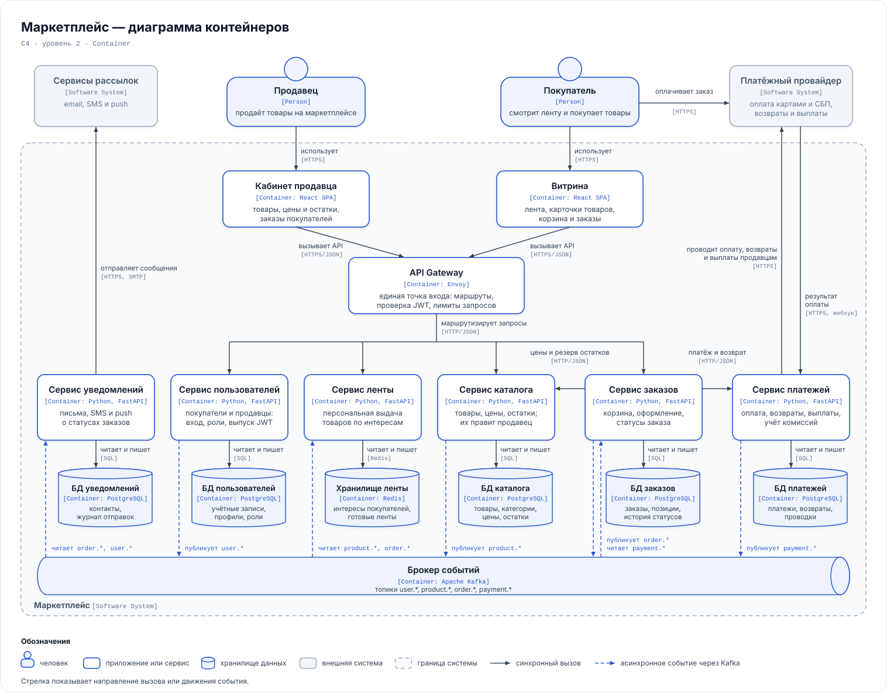

# Маркетплейс: архитектура

Архитектура маркетплейса, на котором продавцы размещают товары, а покупатели получают персональную ленту, оформляют и оплачивают заказы. В репозитории есть C4-диаграмма контейнеров, домены и границы владения данными, варианты разбиения на сервисы с обоснованием выбора и один поднятый сервис — каталог, пока только с health-check. Бизнес-логики на этом этапе нет.

## Запуск

Нужен Docker с Compose.

```bash
docker compose up --build --wait
curl -i http://localhost:8000/health
```

`--wait` дожидается, пока Docker отметит сервис как `healthy`: Docker сам проверяет `/health` каждые 10 секунд. После этого `curl` возвращает `200 OK` и `{"status":"ok"}`, то же можно открыть в браузере: http://localhost:8000/health. В Windows PowerShell вместо `curl` пишите `curl.exe`. Остановить: `docker compose down`.

Health-check пока проверяет только, что процесс жив и отвечает; проверки базы и брокера добавятся вместе с ними.

## Диаграмма контейнеров

[](docs/c4-container.svg)

Сплошные стрелки — синхронные вызовы, синие пунктирные — события через Kafka. Каждый сервис ходит только в своё хранилище.

## Домены

| Домен | Зона ответственности |
|---|---|
| Пользователи | регистрация и вход покупателей и продавцов, профили, роли, выпуск JWT |
| Каталог | карточки товаров, категории, цены и остатки; продавец управляет своими товарами |
| Лента | персональная выдача: учёт просмотров и покупок, интересы покупателя, ранжирование товаров |
| Заказы | корзина, оформление заказа, его статусы от создания до получения или отмены |
| Платежи | оплата через платёжного провайдера, возвраты, учёт по каждому заказу (комиссия маркетплейса и сумма продавцу) и выплаты продавцам |
| Уведомления | письма, SMS и push о смене статуса заказа, история отправок |

**Персонализация.** У каждого покупателя есть веса категорий, которые растут от его просмотров и покупок. Товары в ленте ранжируются по интересу покупателя к их категории и по популярности товара, а новому покупателю без истории показываются просто популярные товары. Ленты пересчитываются в фоне по событиям и хранятся готовыми, поэтому запрос ленты — это чтение из Redis. Машинного обучения на этом этапе нет: его можно добавить внутри сервиса ленты, не трогая остальные.

## Сервисы и домены

Каждый домен — отдельный сервис. Кроме них на диаграмме два клиентских приложения — витрина для покупателей и кабинет продавца — и два инфраструктурных контейнера: API Gateway и брокер событий.

| Сервис | Домен | Почему отдельно |
|---|---|---|
| Сервис пользователей, `user-service` | Пользователи | хранит пароли и персональные данные, их безопаснее держать отдельно от остального кода. Выпускает JWT, а подпись токенов проверяет API Gateway |
| Сервис каталога, `catalog-service` | Каталог | пишут продавцы, читают все; нагрузка на чтение высокая, поэтому сервис масштабируется своими экземплярами |
| Сервис ленты, `feed-service` | Лента | самый нагруженный путь чтения и своё хранилище под готовые ленты; алгоритм выдачи меняется часто и не должен задевать заказы |
| Сервис заказов, `order-service` | Заказы | центр оформления: статусы заказа и сага с каталогом и платежами |
| Сервис платежей, `payment-service` | Платежи | единственный, кто работает с деньгами и провайдером: изоляция сужает круг кода с доступом к платёжным данным и упрощает аудит |
| Сервис уведомлений, `notification-service` | Уведомления | работает только в фоне, по событиям; сбой рассылки не должен мешать оформить заказ |
| API Gateway (Envoy) | — | единая точка входа для витрины и кабинета продавца: маршрутизация, проверка JWT по публичным ключам `user-service`, передача сервисам id и роли пользователя в заголовках, лимиты запросов. Envoy проверяет JWT без доработок |
| Kafka | — | события между сервисами: одно событие читают несколько сервисов, а события хранятся несколько недель, поэтому копии данных у ленты можно собрать заново |

Границы проведены по бизнес-возможностям: внутри домена данные меняются вместе, а между доменами связь слабая, и её можно сделать явной через API или события. Кроме того, у доменов разный профиль нагрузки (лента и каталог — чтение, заказы и платежи — запись с транзакциями, уведомления — фоновая очередь), разные требования к надёжности и безопасности и разный темп изменений.

## Данные и взаимодействия

### Кто чем владеет

| Сервис | Хранилище | Владеет данными | Отвечает за |
|---|---|---|---|
| `user-service` | PostgreSQL | учётные записи, профили покупателей и продавцов, роли | вход, выпуск JWT, события `user.*` |
| `catalog-service` | PostgreSQL | товары, категории, цены, остатки и их резервы | управление карточками, резерв остатков и его снятие, события `product.*` |
| `feed-service` | Redis с записью на диск (AOF) | интересы покупателей, просмотры, готовые ленты, копия карточек товаров для выдачи | построение и выдачу ленты |
| `order-service` | PostgreSQL | корзины, заказы, позиции с ценой на момент покупки, история статусов | оформление заказа, его статусы, события `order.*` |
| `payment-service` | PostgreSQL | платежи, возвраты, выплаты продавцам, проводки: комиссия и доля продавца | оплату, возвраты, выплаты, учёт, события `payment.*` |
| `notification-service` | PostgreSQL | копия контактов получателей, шаблоны, журнал отправок | отправку уведомлений |

Общих баз нет: к хранилищу обращается только его сервис. Чужие данные сервис получает через API владельца или держит у себя копию: лента и уведомления собирают её из событий (карточки товаров, контакты), а заказ сохраняет цену, которую получил от каталога при оформлении.

Кто делает запрос, сервисы узнают из заголовков, которые API Gateway заполняет по проверенному JWT. Например, `catalog-service` разрешает менять товар только его продавцу.

### Как сервисы общаются

| Откуда → куда | Зачем | Способ |
|---|---|---|
| витрина, кабинет продавца → API Gateway | все запросы пользователей | синхронно, HTTPS/JSON |
| API Gateway → `user-`, `catalog-`, `feed-`, `order-service` | маршрутизация запросов, в том числе запрос ленты и отметки о просмотрах для `feed-service` | синхронно, HTTP/JSON |
| API Gateway → `user-service` | публичные ключи для проверки JWT (JWKS), с кэшем | синхронно, HTTP |
| `order-service` → `catalog-service` | сверить цены и зарезервировать остатки при оформлении, снять резерв при отмене | синхронно, HTTP/JSON |
| `order-service` → `payment-service` | создать платёж и получить ссылку на оплату, запросить возврат при отмене оплаченного заказа | синхронно, HTTP/JSON |
| покупатель → платёжный провайдер | оплатить заказ на странице провайдера | синхронно, HTTPS |
| `payment-service` → платёжный провайдер | провести оплату, возврат или выплату продавцу | синхронно, HTTPS |
| платёжный провайдер → `payment-service` | результат оплаты | вебхук, HTTPS |
| `notification-service` → сервисы рассылок | отправить письмо, SMS или push | синхронно, HTTPS и SMTP |
| `user-service` → `notification-service` | `user.*`: пользователь зарегистрировался или изменил контакты | асинхронно, Kafka |
| `catalog-service` → `feed-service` | `product.*`: товар создан, изменён или снят с продажи | асинхронно, Kafka |
| `order-service` → `feed-service`, `notification-service` | `order.*`: заказ создан, сменился статус | асинхронно, Kafka |
| `payment-service` → `order-service` | `payment.*`: оплата прошла или не прошла, сделан возврат | асинхронно, Kafka |

Синхронно — там, где ответ нужен сразу: без актуальной цены и остатка заказ не оформить, без ссылки на оплату покупатель не заплатит. Асинхронно — там, где отправителю не важно, кто и когда обработает событие (лента, уведомления), и там, где результат приходит позже (оплата).

Вебхук провайдера приходит на отдельный публичный адрес `payment-service`, мимо API Gateway: это вызов не пользователя, а провайдера, JWT у него нет. Поэтому `payment-service` проверяет подпись провайдера на каждом вебхуке.

### Оформление заказа по шагам

1. Витрина → API Gateway → `order-service`: оформить корзину. Заказ создаётся в статусе «создан».
2. `order-service` → `catalog-service`: сверить цены и зарезервировать остатки.
3. `order-service` → `payment-service` → платёжный провайдер: создать платёж. Покупатель получает ссылку и платит на странице провайдера.
4. Провайдер присылает результат вебхуком, `payment-service` записывает платёж и проводки и публикует `payment.succeeded` или `payment.failed`.
5. `order-service` переводит заказ в «оплачен» или отменяет его и снимает резерв в каталоге, затем публикует `order.status_changed`. Если оплата не пришла за отведённое время, например за 15 минут, `order-service` отменяет заказ сам.
6. `notification-service` присылает покупателю уведомление, `feed-service` учитывает покупку в интересах.

Шаги 2–5 — сага: вместо одной транзакции у заказа явные статусы и компенсации — снять резерв, если оплата не прошла или истекла, и вернуть деньги, если оплаченный заказ отменили. Сервис записывает событие в свою базу в той же транзакции, что и изменение данных, а отдельный процесс отправляет его в Kafka (outbox), поэтому событие не теряется. Обработчики идемпотентны: повторно доставленное событие ничего не ломает.

## Варианты декомпозиции

**Вариант 1. Модульный монолит.** Одно приложение с модулями по тем же шести доменам и одна база PostgreSQL со схемой на модуль. Пересчёт ленты и рассылка уведомлений — фоновые задачи того же приложения.

**Вариант 2. Три укрупнённых сервиса.** «Аккаунты» (пользователи), «Коммерция» (каталог, заказы и платежи с общей базой) и «Вовлечение» (лента и уведомления).

**Вариант 3. Сервис на домен.** Шесть сервисов, API Gateway и Kafka — то, что на диаграмме.

## Плюсы и минусы

**Вариант 1. Модульный монолит**

Плюсы:
- заказ и резерв остатка меняются в одной транзакции БД, а результат оплаты обрабатывается в той же базе: не нужны распределённая сага и outbox;
- один деплой и один процесс: проще запускать, отлаживать и тестировать, нет сетевых задержек между модулями.

Минусы:
- лента масштабируется только вместе со всем приложением, хотя читают её в разы чаще, чем оформляют заказы;
- утечка памяти или зависание в одном модуле, например в пересчёте ленты, роняет и оформление заказов;
- платёжный код и платёжные данные живут в одном процессе и одной базе со всем остальным: к ним шире доступ и сложнее аудит;
- границы модулей держатся только на дисциплине: общая база подталкивает к join'ам между доменами, и модули постепенно срастаются.

**Вариант 2. Три укрупнённых сервиса**

Плюсы:
- каталог, заказы и платежи живут в одной базе «Коммерции»: резерв и учёт оплаты обходятся без распределённой саги и outbox между ними;
- инфраструктуры меньше, чем в варианте 3: три сервиса и три базы;
- лента и уведомления уже отделены от оформления заказов.

Минусы:
- «Коммерция» — большой сервис: каталог (частые правки продавцов, много чтения) и платежи (редкие осторожные релизы, строгие требования безопасности) выкатываются и масштабируются вместе;
- во «Вовлечении» соседствуют лента (быстрые синхронные ответы) и уведомления (фоновая очередь): всплеск рассылок бьёт по выдаче ленты;
- границы проведены по удобству, а не по доменам: с ростом нагрузки «Коммерцию» всё равно придётся делить.

**Вариант 3. Сервис на домен**

Плюсы:
- каждый сервис масштабируется под свою нагрузку: лента и каталог — экземплярами под чтение, платежи — отдельно;
- отказы изолированы: падение ленты или уведомлений не мешает оформить и оплатить заказ;
- с деньгами и провайдером работает только `payment-service`;
- владение данными однозначное: у каждого сервиса своя база, чужие данные — только через API или события;
- сервисы можно разрабатывать и выкатывать по одному.

Минусы:
- оформление заказа распределено по трём сервисам: вместо одной транзакции — сага с компенсациями, и статусы согласуются не мгновенно;
- нужны outbox и идемпотентные обработчики, чтобы события не терялись и не дублировали действия;
- инфраструктуры больше: Kafka, шесть хранилищ, API Gateway; для отладки нужны трейсинг и сквозной id запроса;
- синхронные цепочки (заказ → каталог, заказ → платежи) добавляют сетевые задержки и точки отказа.

## Итоговый выбор

Выбран вариант 3 — сервис на домен.

**Допущения.** Ленту и каталог читают на порядки чаще, чем оформляют заказы. Над системой работают несколько команд. Платёжный контур проходит отдельную проверку безопасности. Сервисы будут появляться по одному, начиная с каталога.

Аргументы из требований кейса:

- **Персонализированная лента** — главный путь чтения. Ей нужны своё хранилище под готовые ленты и отдельное масштабирование, а её алгоритм будет меняться чаще остального. В монолите и во «Вовлечении» варианта 2 она делит ресурсы с тем, что с ней не связано.
- **Расчёт и учёт платежей** требуют изоляции: единственный сервис с доступом к деньгам и провайдеру проще защитить и проверить. В вариантах 1 и 2 платежи живут рядом с каталогом.
- **Уведомления** асинхронны по своей природе: отдельный сервис на событиях ничего не теряет, а сбой рассылки не останавливает продажи.
- **Продавцы и покупатели** нагружают систему по-разному: продавцы правят каталог, покупатели читают ленту и оформляют заказы. Раздельные сервисы масштабируют эти сценарии независимо.
- **Минусы варианта 3 управляемы.** Распределённая часть — одна сага из двух шагов (резерв и оплата) с явными статусами заказа, а доставку событий закрывают outbox и идемпотентность.
- **Систему можно наращивать по шагам:** сервисы поднимаются и развиваются по одному. Сейчас поднят `catalog-service`, остальные добавятся так же.

Модульный монолит был бы лучше для небольшой команды и первой версии без большой нагрузки на ленту: он проще и дешевле в эксплуатации. При наших допущениях его минусы — общее масштабирование и общий доступ к платёжным данным — перевешивают.

## Структура репозитория

```
docs/c4-container.svg     диаграмма контейнеров C4
services/catalog/         catalog-service: FastAPI, GET /health
docker-compose.yml        запуск сервиса
```
